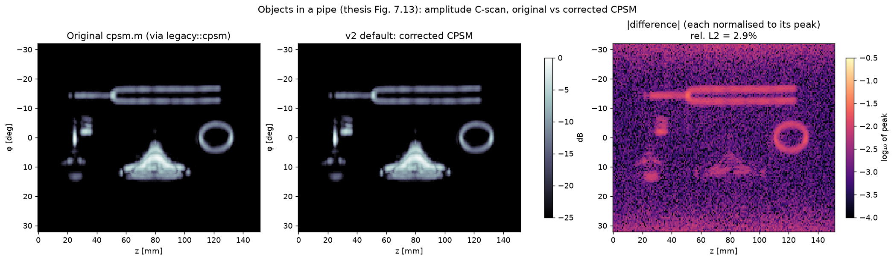
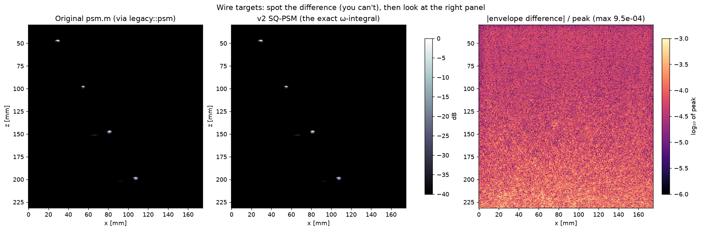
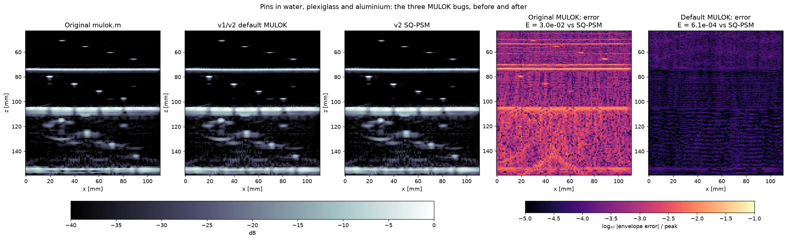

# Gallery: the original, and what v2 does by default

Three before-and-after comparisons, narrated by our two field assistants:

- 🦡 **The badger**: stubborn, sceptical, refuses to accept "looks the same" without a difference map.
- 🦝 **The raccoon**: goes through frequency *bins* for a living, and finds what the original threw away.

The pictures: "Original" means the original MATLAB/Octave code, computed through the `legacy` ports, which match it to about 1e-15 (test T1/T7). "v2" means what you get by default: no flags, no `legacy::`, nothing forced.

Thesis figures are shown straight from the [original repository](https://github.com/mh-skjelvareid/synaptus) at commit `3ffbe45` for comparison. Ours are recomputed from the same datasets.

Regenerate everything with:
```
cargo run --release --example gallery_v2     # computes the arrays
python3 -I figures/plot_gallery.py           # renders figures/gallery/*.png
```

---

## 1. Objects in a pipe: the CPSM that got fixed

**The original figure** (thesis Fig. 7.13, from the upstream repository):


and the focused C-scan from the Synaptus README:


**Ours:**



The original `cpsm.m` does four things the derivation doesn't:
1. It pretends the 64° scanned arc is a full circle, which gives non-integer angular orders.
2. It lets evanescent components through with zero phase instead of removing them.
3. It includes the DC bin.
4. It uses an amplitude factor that is the reciprocal of the thesis' own asymptotic formula.

The v2 default fixes the first three and uses the Hankel-ratio transfer function for the fourth.

🦝 The raccoon found items 1–3 in the bins. Item 3 was literally a bin: the DC one.

What changes:
- **The objects stay where they were.** Only 1.5% of the bright pixels move to a different range sample.
- **Brightness changes by 2.9% overall:** 1.9% from the three fixes and 2.3% from the transfer function (they partly overlap). The difference panel shows it landing on the fork and the ring.
- **Not proven:** that the new brightness is *right*. The angle-independent physics model is still the same, and the amplitude question (dossier C8) is still open. The corrected version does locate synthetic scatterers within half a sample (test T9). So does the original, which is why this section says "consistent", not "better".

`pipe_attribution.txt` has the split.

🦡 The badger notes that we fixed four things and the picture barely moved. Correct and boring beats wrong and exciting. It makes a poor trailer, though.

---

## 2. Wire targets: spot the difference

**The original figure:** none that we checked. The `graphics/` folder of the upstream repository has no picture of this dataset.

**Ours:**



Left: what `psm.m` computes. Middle: the exact frequency integral it approximates (SQ-PSM). You can't tell them apart, and that's the point.

The right panel shows the difference anyway. It's at most 9.5e-4 of the peak, and it **grows with depth**: about 1.3e-4 in the top tenth of the image and 6.9e-4 in the bottom tenth. That's the rectangle-rule error of PSM's frequency sum, and deeper means more phase to get wrong. It won't change a diagnosis, but it's the error v1's accuracy reports were really measuring.

🦡 The badger wants it on record that "you can't see it" and "it isn't there" are different claims. The right panel is the difference.

---

## 3. Pins in three layers: the MULOK bugs, before and after

**The closest original figure** (thesis Fig. 5.5). It's a different dataset with the same layer materials, flat-bottom holes instead of side-drilled ones (going by the dataset names), so compare the style, not the pixels:


**Ours:**



The first three panels look nearly identical at −40 dB, which is how bugs like these survive for years. The error maps tell a different story:
- **Original `mulok.m`** has an envelope error of **3.0e-2** against the exact integral. The error sits exactly where the signal is: every interface, every pin, and a V-shaped ghost in the aluminium.
- **The default MULOK** (thesis-correct Jacobian, full kz grid, correct frequency axis, better interpolation) has an error of **6.1e-4**, about 50× smaller, and spread out like noise.

Each of the three bugs (squared Jacobian, truncated kz grid, frequency axis off by 0.75 bins) is measured separately in `../synaptus-rs/ACCURACY.md` §4.1.

🦝 The raccoon is especially proud of the 0.75-bin one. It was hiding in plain sight, three quarters of a bin from where everyone was looking.

---

### Small print

- The figures here are computed; the thesis figures are pictures of a figure. Colour maps and dB ranges differ, and the C-scan uses φ in degrees where the thesis uses arc length.
- None of these defaults reproduce a known bug. The faithful copies live under `legacy::`, and they only run when called by name, as they are here, for the "before" pictures.
- "Exact integral" means the m → ∞ limit of PSM's own model, checked against an independent quadrature at 24 pixels (`ACCURACY_V2.md`). It isn't a statement about the physical specimen.
